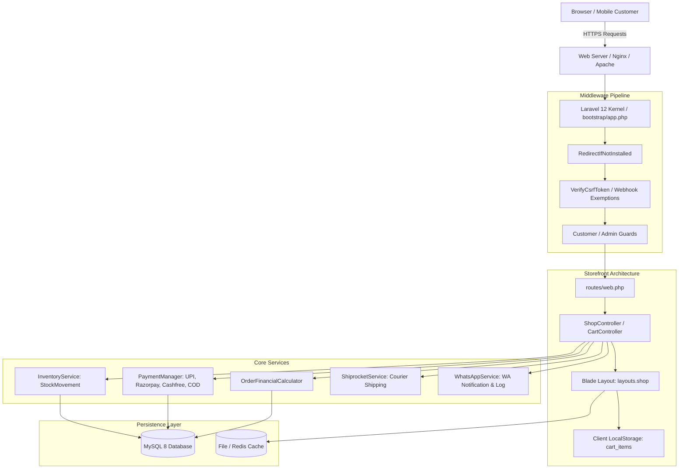
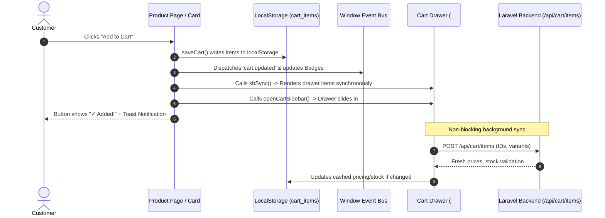
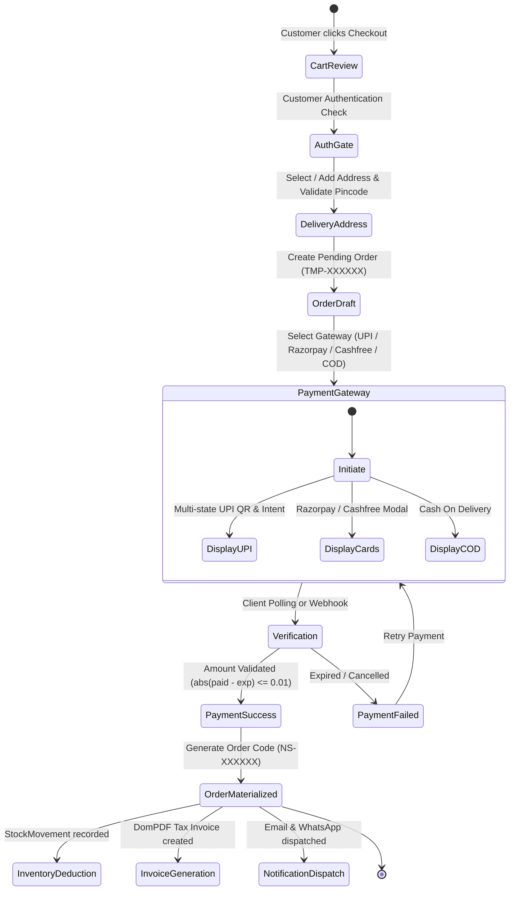

# Nool & Crop — Complete Codebase Architecture & System Documentation

> **Version:** 2.0 (Production-Ready)  
> **Framework:** Laravel 12.x (PHP 8.2+)  
> **Database:** MySQL 8.0+  
> **Domain:** [noolandcrop.in](https://noolandcrop.in)  
> **Location:** Tirunelveli, Tamil Nadu, India  
> **Last Verified & Tested:** October 2026 (194 Tests Passed · 1,095 Assertions)

---

## Table of Contents
1. [Executive Summary & Brand Context](#1-executive-summary--brand-context)
2. [Technology Stack & Core Dependencies](#2-technology-stack--core-dependencies)
3. [System Architecture & Data Flow](#3-system-architecture--data-flow)
4. [Complete Directory & File Structure](#4-complete-directory--file-structure)
5. [Database Architecture & 33 Data Models](#5-database-architecture--33-data-models)
6. [Services & Business Logic Layer](#6-services--business-logic-layer)
7. [HTTP Controllers & Request Handling](#7-http-controllers--request-handling)
8. [Complete Routing & API Catalog](#8-complete-routing--api-catalog)
9. [Frontend Design System & Blade Layouts](#9-frontend-design-system--blade-layouts)
10. [Cart & State Synchronization Engine](#10-cart--state-synchronization-engine)
11. [Checkout, Payment & Webhook Lifecycle](#11-checkout-payment--webhook-lifecycle)
12. [Order Management, Invoicing & Logistics](#12-order-management-invoicing--logistics)
13. [Customer Authentication & Security Hardening](#13-customer-authentication--security-hardening)
14. [Admin Control Center & Customization Suite](#14-admin-control-center--customization-suite)
15. [Automated Installer Wizard](#15-automated-installer-wizard)
16. [Automated Testing Suite (PHPUnit)](#16-automated-testing-suite-phpunit)
17. [Live Deployment & Server Maintenance Guide](#17-live-deployment--server-maintenance-guide)

---

## 1. Executive Summary & Brand Context

**Nool & Crop** is an enterprise-grade, high-performance Direct-to-Consumer (D2C) e-commerce web platform engineered for modern retail fashion and apparel. It is built natively on **Laravel 12**, **Vanilla CSS3 Design Tokens**, and **Modern Vanilla JavaScript**.

### Key Brand Characteristics
- **Brand Name:** Nool & Crop
- **Headquarters:** Tirunelveli, Tamil Nadu, India
- **Core Product Lines:** Men's T-Shirts, Oversized Tees, Polo T-Shirts, Hoodies, Daily Essentials.
- **Brand Colors:**
  - Primary Brand Blue: `#0068E1`
  - Secondary Dark: `#292D32`
  - Accent Green: `#10B981`
  - Background Tint: `#F0F6FF` / `#F8FAFC`
- **Customer Experience Philosophy:** Instant responsive interactions, zero page-reload lag for carting, frictionless mobile-first checkout, multi-channel payment (UPI Intent/QR, Razorpay, Cashfree, COD), transparent tracking via Indian 10-digit mobile number, and automated GST/Tax invoices.

---

## 2. Technology Stack & Core Dependencies

### Backend Stack
| Component | Technology / Version | Role |
| :--- | :--- | :--- |
| **Language** | PHP 8.2+ (Strict Types enabled) | Core application runtime |
| **Framework** | Laravel 12.x | MVC architecture, routing, ORM, queue handling |
| **Database** | MySQL 8.0+ / MariaDB 10.4+ | Relational persistence with foreign keys & performance indexes |
| **PDF Engine** | `barryvdh/laravel-dompdf` (^3.1) | Dynamic generation of PDF Tax Invoices & Shipping Slips |
| **Queue Worker** | Database / Redis (`php artisan queue:work`) | Non-blocking email dispatch, invoice generation, webhooks |
| **Session & Cache** | File / Database / Redis driver | Multi-level cache (`StoreSetting`, Categories, Banners) |

### Frontend & Styling Stack
| Component | Technology | Implementation Details |
| :--- | :--- | :--- |
| **Storefront CSS** | Vanilla CSS3 Custom Properties | Fully customized design system without heavy frameworks like Bootstrap |
| **Admin Panel CSS** | Bootstrap 3.4.1 + Custom Admin Styles | Fast, functional enterprise dashboard with Summernote WYSIWYG editor |
| **Icons** | Line Awesome (`las`) & Font Awesome 6.x | Crisp vector typography across header, drawer, and action buttons |
| **Storefront JS** | Native ES6+ JavaScript | Debounced search, reactive localStorage cart, drawer sidebar, toast engine |
| **Build Tools** | Vite 7.0 + `@tailwindcss/vite` | Asset minification and build pipeline |

---

## 3. System Architecture & Data Flow



---

## 4. Complete Directory & File Structure

```text
noolandcrop/
├── app/
│   ├── Console/
│   │   └── Commands/
│   │       ├── AppInstallCommand.php          # CLI installer command
│   │       ├── AppResetInstallCommand.php    # CLI reset utility
│   │       ├── BackfillCategorySlugs.php     # SEO slug generator for categories
│   │       └── BackfillProductSlugs.php      # SEO slug generator for products
│   ├── Http/
│   │   ├── Controllers/
│   │   │   ├── Admin/                         # 21 Admin controllers (Dashboard, Orders, Inventory, etc.)
│   │   │   ├── Install/                       # Web GUI Application Installer
│   │   │   ├── Shop/                          # 10 Customer Storefront controllers (Cart, Shop, Login, etc.)
│   │   │   ├── InvoiceController.php          # Invoice generation & DomPDF rendering
│   │   │   └── TemplateController.php         # Visual billing template customizer
│   │   └── Middleware/
│   │       ├── AdminMiddleware.php            # Verifies is_admin flag
│   │       ├── CompressResponse.php           # Gzip/Brotli response compression
│   │       ├── EnsureCustomerAuthenticated.php# Customer guard gatekeeper
│   │       ├── RedirectIfInstalled.php        # Prevents re-running installer
│   │       └── RedirectIfNotInstalled.php     # Auto-redirects to /install if .env missing
│   ├── Mail/
│   │   ├── AdminOrderNotificationMail.php     # Notifies store owner of new orders
│   │   ├── OrderInvoiceMail.php               # Delivers DomPDF invoice attachment to customer
│   │   └── OrderStatusChangedMail.php         # Customer update on dispatch/delivery
│   ├── Models/                                # 33 Eloquent Data Models
│   ├── Providers/
│   │   └── AppServiceProvider.php             # Core bindings, rate limiting, view composers
│   ├── Services/
│   │   ├── Install/                           # EnvironmentManager & RequirementsChecker
│   │   ├── Inventory/                         # InventoryService & stock tracking
│   │   ├── Order/                             # OrderFinancialCalculator & OrderService
│   │   ├── Payment/                           # Multi-gateway drivers (UPI, Razorpay, Cashfree, COD)
│   │   ├── Pincode/                           # Serviceable Pincode & Delivery ETA Service
│   │   ├── Shipping/                          # Shiprocket Courier API Integration
│   │   ├── BonusService.php                   # Bonus discount logic
│   │   ├── OtpService.php                     # Cryptographic 6-digit OTP engine
│   │   ├── UpiPaymentService.php              # Dynamic UPI QR & Intent link builder
│   │   ├── WaWalletService.php                # WhatsApp credit ledger
│   │   └── WhatsAppService.php                # WhatsApp Business API notifications
│   └── Traits/
│       └── HasCustomAsset.php                 # Resilient asset/storage URL resolution
├── bootstrap/
│   └── app.php                                # Laravel 12 application bootstrap & middleware aliases
├── config/                                    # Configuration files (app, auth, database, mail, queue, etc.)
├── database/
│   ├── factories/                             # Model factories for testing
│   ├── migrations/                            # 53 Database migrations
│   └── seeders/                               # Seeders for store data, templates, gateways
├── docs/
│   └── brand-guidelines.md                    # Official Brand Guidelines, tokens, and voice
├── public/
│   ├── assets/                                # Front-end static assets (fonts, icons, styles)
│   ├── storage/                               # Symbolic link to storage/app/public
│   ├── index.php                              # Public HTTP entry point
│   └── .htaccess                              # Apache URL rewriting & security headers
├── resources/
│   └── views/
│       ├── admin/                             # Admin views (Blade templates for control center)
│       ├── emails/                            # Responsive HTML transactional email templates
│       ├── install/                           # GUI Installer wizard templates
│       ├── layouts/
│       │   ├── admin.blade.php                # Master layout for Admin panel
│       │   └── shop.blade.php                 # Master layout for Storefront (Header, Nav, Footer, Drawer)
│       └── shop/                              # Storefront views (Home, Product, Cart, Checkout, etc.)
├── routes/
│   ├── console.php                            # Artisan scheduled tasks
│   └── web.php                                # All Web, API, and Webhook routes (450 lines)
├── tests/
│   ├── Feature/                               # 18 Comprehensive feature test suites
│   ├── Unit/                                  # Unit tests
│   └── TestCase.php                           # Base test case setup
└── storage/                                   # Logs, cache, framework sessions, uploaded media
```

---

## 5. Database Architecture & 33 Data Models

The system maintains 33 Eloquent Models governing all operational workflows:

### A. Customer & Identity Models
1. **`User`** (`users` table):
   - Handles both store administrators (`is_admin = 1`) and retail customers (`is_admin = 0`).
   - Fields: `name`, `email`, `mobile`, `password`, `is_admin`, `avatar`, `email_verified_at`, `status`.
2. **`CustomerAddress`** (`customer_addresses` table):
   - Stores multiple delivery addresses per customer with a designated `is_default` flag.
   - Fields: `user_id`, `name`, `mobile`, `address_line1`, `address_line2`, `city`, `state`, `pincode`, `landmark`, `type` (`home`/`work`).
3. **`OtpCode`** (`otp_codes` table):
   - Handles passwordless authentication and verification with strict 5-minute expiry.
   - Fields: `mobile`, `email`, `otp`, `expires_at`, `attempts`, `is_used`.

### B. Catalog & Product Inventory Models
4. **`Category`** (`categories` table):
   - Hierarchical category structure (`parent_id`) with automatic slugging and sort ordering.
   - Relationships: `parent()`, `children()`, `products()`.
5. **`Product`** (`products` table):
   - Central product catalog entity with SKU, pricing, discount percentages, stock, ratings, and variants.
   - Relationships: `categories()`, `variations()`, `images()`, `colors()`, `options()`, `reviews()`, `providers()`.
6. **`ProductVariation`** (`product_variations` table):
   - SKU-level variants (e.g. Size `M`, `L`, `XL`, or Color `Navy Blue`, `Black`) with individual price overrides and stock.
7. **`ProductColor`** (`product_colors` table):
   - Visual color palette selector per product (hex codes + display labels).
8. **`ProductOption`** (`product_options` table):
   - Custom attributes (e.g. Material: Cotton, Fit: Oversized).
9. **`ProductImage`** (`product_images` table):
   - Gallery image entries with sort order.
10. **`ProductVariationImage`** (`product_variation_images` table):
    - Variant-specific image mapping for live preview upon swatch selection.
11. **`Provider`** (`providers` table):
    - Suppliers and manufacturers mapped to products via `product_provider` pivot.
12. **`DescPreset`** (`desc_presets` table):
    - Reusable rich-text description templates for quick admin catalog entry.
13. **`StockMovement`** (`stock_movements` table):
    - Immutable audit ledger recording every inventory adjustment, order deduction, return restock, and manual update.

### C. Order, Invoicing & Logistics Models
14. **`Order`** (`orders` table):
    - Primary order entity. Uses user-friendly non-sequential public order codes (`NS-XXXXXX`) and temporary IDs (`TMP...`) during pending checkout.
    - Fields: `order_code`, `user_id`, `status` (`pending`, `confirmed`, `processing`, `dispatched`, `delivered`, `cancelled`, `returned`), `payment_status` (`unpaid`, `paid`, `refunded`), `payment_method`, `total_amount`, `discount_amount`, `shipping_amount`, `tax_amount`, `customer_address_id`, `courier_name`, `awb_code`, `tracking_url`.
    - Soft-deletes enabled (`deleted_at`).
15. **`OrderItem`** (`order_items` table):
    - Line-item breakdown of purchased items with frozen snapshot pricing, variant titles, and SKU.
16. **`OrderReturn`** (`order_returns` table):
    - Customer cancellation and return requests with reason, image proof, admin approval status, and refund notes.
17. **`Invoice`** (`invoices` table):
    - Generated tax invoice entries referencing an order, billing template, sequential invoice number, and DomPDF storage path.
18. **`BillingTemplate`** (`billing_templates` table):
    - Customizable HTML invoice design presets (Logo, headers, terms, signatures, colors).
19. **`OtherCharge`** (`other_charges` table):
    - Configurable checkout surcharges (e.g. COD handling fee, gift packing).
20. **`ServiceablePincode`** (`serviceable_pincodes` table):
    - Delivery validation database with delivery days ETA, COD availability, and shipping fee overrides.

### D. Payments & Financial Models
21. **`PaymentGateway`** (`payment_gateways` table):
    - Multi-gateway registry storing configuration for UPI, Razorpay, Cashfree, and COD.
22. **`Coupon`** (`coupons` table):
    - Discount codes with minimum order values, fixed/percentage discounts, usage limits, and expiration dates.
23. **`Bonus`** (`bonuses` table):
    - Tiered discount perks (e.g. "Flat ₹50 off orders above ₹999").

### E. Store Operations & Customization Models
24. **`StoreSetting`** (`store_settings` table):
    - Key-value configuration engine with in-memory static caching and `Cache::rememberForever`.
    - Controls store name, logos, contact info, free shipping threshold, SEO meta tags, social media links, and color themes.
25. **`Banner`** (`banners` table):
    - Interactive storefront sliders, hero banners, and promotional tiles with soft-delete support.
26. **`MediaFile`** (`media_files` table):
    - Centralized media asset manager tracking uploaded image files, dimensions, mime-types, and soft-delete recovery.
27. **`Review`** (`reviews` table):
    - Customer product reviews with star ratings (1-5), verified purchase flags, and admin moderation workflow (`pending`, `approved`, `rejected`).
28. **`Wishlist`** (`wishlists` table):
    - Customer saved products for later purchase.
29. **`SupportTicket`** (`support_tickets` table):
    - Customer issue ticketing system with unique ticket codes and priority flags.
30. **`SupportMessage`** (`support_messages` table):
    - Back-and-forth conversational thread messages between admin and customer.

### F. WhatsApp Communication Models
31. **`WaApiSetting`** (`wa_api_settings` table):
    - Cloud WhatsApp API credentials, instance IDs, and webhook secrets.
32. **`WaMessageLog`** (`wa_message_logs` table):
    - Audit log of automated WhatsApp alerts (Order Confirmed, Dispatched, Delivered, OTPs).
33. **`WaTransaction`** (`wa_transactions` table):
    - Pre-paid messaging credits ledger.

---

## 6. Services & Business Logic Layer

The business logic is abstracted into dedicated, testable services under `app/Services/`:

### `OrderFinancialCalculator` (`app/Services/Order/OrderFinancialCalculator.php`)
- Calculates exact line item totals, GST/Tax breakdown, coupon discounts, bonus tiers, shipping charges, and extra fees.
- Enforces strict currency arithmetic avoiding floating-point precision errors.

### `PaymentManager` & Payment Drivers (`app/Services/Payment/`)
- Unified interface `PaymentGatewayInterface`:
  - `initiatePayment(Order $order): array`
  - `verifyPayment(Request $request, Order $order): bool`
  - `processWebhook(Request $request): Response`
- **Supported Drivers:**
  - `UpiGateway.php` & `UpiPaymentService.php`: Generates dynamic Indian UPI QR codes and UPI Intent links (`upi://pay?pa=...&pn=...&am=...&tr=...`) with automated 3-second client polling.
  - `RazorpayGateway.php`: Official Razorpay checkout order generation and cryptographic HMAC-SHA256 signature verification.
  - `CashfreeGateway.php`: Cashfree PG order token creation and webhook handler.
  - `CodGateway.php`: Cash on Delivery verification with optional extra charges.

### `InventoryService` (`app/Services/Inventory/InventoryService.php`)
- Thread-safe inventory deductions upon order placement.
- Automatic restocking on cancellation or accepted return.
- Generates detailed `StockMovement` audit logs (`type`: `sale`, `return`, `adjustment`, `restock`).

### `ShiprocketService` (`app/Services/Shipping/ShiprocketService.php`)
- Authenticates with Shiprocket API, checks pickup serviceability, creates shipments, generates AWB tracking numbers, and fetches shipping labels.

### `OtpService` (`app/Services/OtpService.php`)
- Generates cryptographically secure 6-digit OTPs using `random_int(100000, 999999)`.
- Strictly limits attempts (max 5 per window) and invalidates tokens after 5 minutes.
- Redacts OTP tokens from logs and JSON responses to prevent credential leaks.

### `WhatsAppService` (`app/Services/WhatsAppService.php`)
- Sends automated transactional WhatsApp updates for order status transitions, delivery notifications, and customer OTPs.

---

## 7. HTTP Controllers & Request Handling

### A. Storefront Controllers (`app/Http/Controllers/Shop/`)
- **`ShopController.php`**: Renders Home page, catalog browse, category pages, product details, deals, and live search. Eager-loads ratings (`withAvg('reviews', 'rating')`) to eliminate N+1 queries.
- **`CartController.php`**: Cart rendering, `/api/cart/items` price/stock verification, and `/buy-now` checkout processing.
- **`LoginController.php`**: Customer authentication (Email/Mobile OTP login, registration, password login, profile management, password resets).
- **`OrdersController.php`**: Customer order tracking (`/track-order`), order history, cancellations, returns, and invoice downloads.
- **`PaymentController.php`**: Handles `/pay/{token}`, client payment verification, and webhook callbacks.
- **`AddressController.php`**: Customer shipping address CRUD operations.
- **`CouponController.php`**: Validates promo codes and returns available customer coupons.
- **`PincodeController.php`**: Validates delivery postal codes and calculates estimated delivery dates.
- **`ReviewController.php`**: Receives customer product reviews.
- **`SupportController.php`**: Customer help desk and support ticket management.

### B. Admin Controllers (`app/Http/Controllers/Admin/`)
- **`AdminDashboardController.php`**: Master analytics (sales curves, revenue, active orders, customer counts, low stock alerts, quick settings).
- **`ProductController.php`**: Full catalog management, bulk actions, variant matrix builder, image gallery uploads.
- **`OrderController.php`**: Order status workflows, dispatching, Shiprocket AWB generation, label downloads, refunds.
- **`CategoryController.php`**: Category taxonomy, nesting, image assignment, reordering.
- **`BannerController.php`**: Hero sliders and banner grid configurations.
- **`InventoryController.php`**: Real-time stock overview, threshold alerts, manual adjustments.
- **`AppearanceFilesController.php`**: Media manager, bulk image uploader, asset assignment.
- **`ThemeCustomizationController.php`**: Live store color scheme and typography customization.
- **`HomepageSectionController.php`**: Configures homepage product blocks (Hot Deals, New Arrivals, Best Sellers, Featured).
- **`FooterSettingController.php`**: Multi-column footer link and copyright editor.
- **`CancellationReturnController.php`**: Admin moderation of customer return requests.
- **`ReviewController.php`**: Review moderation queue (Approve / Reject / Auto-approve toggle).
- **`ProviderController.php`**: Vendor and supplier database.
- **`UserController.php`**: Customer account management.
- **`PaymentController.php`**: Transaction audit logs and exportable reports.
- **`SocialLinkController.php`**: Header and footer social media links.
- **`BonusController.php`**: Promotional bonus tier configuration.
- **`CouponController.php`**: Coupon code creation and redemption limits.
- **`SupportController.php`**: Admin support ticket replies.

---

## 8. Complete Routing & API Catalog

### Public Storefront Routes
```text
GET   /                                ShopController@home
GET   /products                        ShopController@shop
GET   /shop                            ShopController@shop
GET   /category/{id}                   ShopController@category
GET   /product/{slug}                  ShopController@product
GET   /deals                           ShopController@deals
GET   /wishlist                        ShopController@wishlist
GET   /track-order                     OrdersController@trackOrder
GET   /help                            SupportController@help
GET   /search                          ShopController@search
GET   /api/search/live                 ShopController@liveSearch
GET   /cart                            CartController@show
POST  /api/cart/items                  CartController@items
GET   /api/wishlist/items              LoginController@getWishlistItems
GET   /api/pincode/check               PincodeController@check
GET   /api/payment-methods             Anonymous closure (active gateways)
GET   /robots.txt                      StoreSetting::getValue('robots_txt')
GET   /sitemap.xml                     Dynamic XML sitemap generator
```

### Customer Authentication Routes
```text
GET   /register                        LoginController@showRegister
POST  /register                        LoginController@register (throttled 10/min)
POST  /login/password                  LoginController@loginWithPassword (throttled 10/min)
GET   /login                           LoginController@showEmail
POST  /login                           LoginController@sendOtp (throttled 6/min)
GET   /login/otp                       LoginController@showOtp
POST  /login/otp                       LoginController@verifyOtp (throttled 10/min)
GET   /login/resend                    LoginController@resendOtp (throttled 3/min)
GET   /logout                          LoginController@logout
GET   /forgot-password                 LoginController@showForgotPassword
POST  /forgot-password                 LoginController@sendResetLink
GET   /reset-password/{token}          LoginController@showResetPassword
POST  /reset-password                  LoginController@resetPassword
```

### Authenticated Customer Routes (`middleware: customer`)
```text
GET   /buy-now                         CartController@buyNow
POST  /buy-now                         CartController@placeOrder
GET   /pay/{token}                     PaymentController@show
POST  /pay/{token}/initiate            PaymentController@initiate
POST  /pay/{token}/verify              PaymentController@verifyClientPayment
GET   /pay/{token}/status              PaymentController@status
GET   /pay/{token}/return              PaymentController@return
GET   /order/{order}                   PaymentController@success
GET   /account                         LoginController@showAccount
POST  /account/profile                 LoginController@updateProfile
POST  /account/password                LoginController@updatePassword
POST  /account/addresses               AddressController@store
PUT   /account/addresses/{address}     AddressController@update
DELETE/account/addresses/{address}     AddressController@destroy
POST  /account/addresses/{addr}/defaultAddressController@setDefault
GET   /account/orders                  OrdersController@index
GET   /account/orders/{order}          OrdersController@show
POST  /account/orders/{order}/cancel   OrdersController@cancel
POST  /account/orders/{order}/return   OrdersController@requestReturn
GET   /account/orders/{order}/invoice  OrdersController@invoice
GET   /account/support                 SupportController@index
POST  /account/support                 SupportController@store
GET   /account/support/{ticket}        SupportController@show
POST  /account/support/{ticket}/reply  SupportController@reply
POST  /account/support/{ticket}/close  SupportController@close
GET   /api/coupons/mine                CouponController@myCoupons
POST  /api/wishlist/toggle             LoginController@toggleWishlist
POST  /product/{product}/reviews       ReviewController@store
```

### Payment & Courier Webhook Routes (CSRF-Exempt)
```text
POST  /api/upi/webhook                 PaymentController@webhook
POST  /payment/webhook                 PaymentController@webhook
POST  /api/payment/webhook/{gateway?}  PaymentController@webhook
POST  /api/courier/webhook             OrderController@courierWebhook
```

### Admin Control Center Routes (`middleware: admin`)
```text
GET   /admin/dashboard                 AdminDashboardController@index
GET   /admin/products                  ProductController@index
POST  /admin/products                  ProductController@store
PUT   /admin/products/{product}        ProductController@update
DELETE/admin/products/{product}        ProductController@destroy
POST  /admin/products/bulk-action      ProductController@bulkAction
GET   /admin/orders                    OrderController@index
GET   /admin/orders/{order}            OrderController@show
POST  /admin/orders/{order}/status     OrderController@updateStatus
POST  /admin/orders/{order}/dispatch   OrderController@dispatchOrder
POST  /admin/orders/{order}/shipment   OrderController@createShipment
POST  /admin/orders/{order}/awb        OrderController@generateAwb
GET   /admin/orders/{order}/label      OrderController@downloadLabel
GET   /admin/inventory                 InventoryController@index
POST  /admin/inventory/adjust          InventoryController@adjustStock
GET   /admin/categories                CategoryController@index
GET   /admin/banners                   BannerController@index
GET   /admin/appearance/files          AppearanceFilesController@index
GET   /admin/appearance/theme          ThemeCustomizationController@index
GET   /admin/appearance/sections       HomepageSectionController@index
GET   /admin/appearance/footer         FooterSettingController@index
GET   /admin/invoices                  InvoiceController@index
GET   /admin/invoices/{id}/pdf         InvoiceController@generatePdf
GET   /admin/settings/*                AdminDashboardController (Store, SEO, Tax, SMTP, WA, etc.)
```

---

## 9. Frontend Design System & Blade Layouts

The storefront layout is located at `resources/views/layouts/shop.blade.php` and `resources/views/shop/partials/`.

### Architecture Highlights
- **Single Unified Search Bar:** Positioned prominently below the header logo and actions row. Uses debounced async input (`/api/search/live`) to render real-time product cards and category links without reloading.
- **Cart Count Badges & Dynamic Subtotal:** Synchronized across both desktop navigation and mobile bottom sticky navigation.
- **Sliding Mini-Cart Drawer (`#cartSidebar`):** Flyout panel that appears when an item is added to the cart, allowing instant quantity changes (`+` / `−`), variant inspection, and direct one-click checkout.
- **Responsive Toast Engine:** Floating micro-notifications (`showStoreToast`) with product thumbnails and progress indicators.
- **CSS Design Variables:**
  ```css
  :root {
    --primary-color: #0068E1;
    --primary-hover: #0053B8;
    --secondary-color: #292D32;
    --accent-color: #10B981;
    --danger-color: #EF4444;
    --bg-light: #F8FAFC;
    --border-color: #E2E8F0;
    --text-primary: #1E293B;
    --text-secondary: #64748B;
  }
  ```

---

## 10. Cart & State Synchronization Engine

The cart operates on a **hybrid client-first reactive architecture**, ensuring zero checkout lag even on high-latency connections.



### Key Technical Implementations
1. **Synchronous Immediate Rendering (`sbSync()`):** Reads directly from `localStorage.getItem('cart_items')` to populate the flyout drawer within **0 milliseconds** without awaiting network promises.
2. **Non-Blocking Background Refresh (`sbLoad()`):** Asynchronously contacts `POST /api/cart/items` to refresh prices and ensure stock availability without blocking user actions. If network errors or CSRF token timeouts occur on live hosts, the cached drawer continues to operate smoothly.
3. **Cross-Tab Synchronization (`storage` event):** Changes made in one browser tab instantly update open tabs without manual page reload.
4. **Variant-Safe Identification:** Identifies items using composite identifiers:
   ```javascript
   const itemKey = item.variation_id ? `${item.id}-${item.variation_id}` : `${item.id}`;
   ```

---

## 11. Checkout, Payment & Webhook Lifecycle



### Webhook Security & Idempotency
- All gateway webhooks (`POST /api/payment/webhook/*` and `POST /payment/webhook`) are registered as CSRF-exempt in `bootstrap/app.php`.
- Signatures are verified cryptographically before accepting payload data.
- Server-side amount validation ensures paid amount matches expected order total:
  ```php
  if (abs($paidAmount - $order->total_amount) > 0.01) {
      throw new PaymentException("Amount mismatch detected.");
  }
  ```
- Handlers are strictly **idempotent**: duplicate webhook deliveries do not duplicate orders or double-deduct inventory.

---

## 12. Order Management, Invoicing & Logistics

### Order Status Progression
1. **`pending`**: Payment initiation in progress.
2. **`confirmed` / `processing`**: Payment verified, inventory deducted, awaiting fulfillment.
3. **`dispatched`**: Courier partner assigned, AWB generated, tracking active.
4. **`delivered`**: Package handed over to customer.
5. **`cancelled`**: Cancelled before shipping; inventory automatically restored.
6. **`returned`**: Customer return request approved; stock movement logged.

### Automated Invoicing (`Barryvdh DomPDF`)
- Tax invoices are generated automatically using active billing templates (`BillingTemplate`).
- Features: SGST/CGST/IGST tax breakdowns, customer delivery address, SKU list, HSN codes, authorized digital signature, and download links.

### Shiprocket Logistics Integration
- Direct synchronization from Admin Order Details:
  - Generate Shipment
  - Generate AWB Code
  - Download Printable Shipping Label (PDF)
  - Live Tracking URL generation

---

## 13. Customer Authentication & Security Hardening

1. **Zero PII Leakage:**
   - Public order tracking requires exact 10-digit mobile number matching. Customer contact numbers and email addresses are masked (`+91 ******1594`).
2. **Cryptographically Secure OTP Authentication:**
   - 6-digit OTP generated via `random_int(100000, 999999)`.
   - Max 5 failed attempts per window with automatic expiration after 5 minutes.
   - OTP codes are excluded from logs, error reports, and client payloads.
3. **Route-Level Rate Throttling:**
   - Customer Registration: `throttle:10,1`
   - Password Login: `throttle:10,1`
   - Send OTP: `throttle:6,1`
   - Verify OTP: `throttle:10,1`
   - Resend OTP: `throttle:3,1`
   - Password Reset: `throttle:5,1`
4. **Multi-Guard Separation:**
   - Storefront customers utilize the `customer` guard.
   - Administrators utilize the default `web` guard with `is_admin = 1` middleware enforcement.

---

## 14. Admin Control Center & Customization Suite

The administration panel (`/admin`) provides full control over the storefront:

| Module | Route | Capabilities |
| :--- | :--- | :--- |
| **Analytics Dashboard** | `/admin/dashboard` | Real-time sales charts, revenue metrics, recent orders, inventory alerts |
| **Product Manager** | `/admin/products` | Add/Edit/Delete products, variations, bulk status updates, SKU search |
| **Orders & Shipping** | `/admin/orders` | Order processing, payment status toggles, Shiprocket AWB, invoice generation |
| **Inventory Control** | `/admin/inventory` | Real-time stock audit, manual adjustments, stock movement histories |
| **Categories** | `/admin/categories` | Nested category tree, slugging, drag-and-drop reordering |
| **Media File Manager** | `/admin/appearance/files` | Bulk asset uploads, auto-resize, media library with soft-delete & restore |
| **Theme Customizer** | `/admin/appearance/theme` | Dynamic primary/secondary color pickers, font selections, layout styles |
| **Homepage Sections** | `/admin/appearance/sections`| Control Hot Deals, New Arrivals, Best Sellers, and Featured items |
| **Footer Settings** | `/admin/appearance/footer` | Customize 4-column footer links, company info, and social links |
| **Banners & Sliders** | `/admin/banners` | Reorderable hero sliders, flash sale banners, promotional tiles |
| **Reviews Moderation**| `/admin/reviews` | Approve, reject, or auto-approve customer ratings and reviews |
| **Support Helpdesk** | `/admin/support` | Ticket responses, ticket escalation, resolution tracking |
| **Billing Templates** | `/admin/templates` | Design custom HTML invoice templates with live previews |
| **Store & SEO Config** | `/admin/settings/store` | Site title, currency, WhatsApp support number, sitemap & robots.txt |

---

## 15. Automated Installer Wizard

For quick setup on fresh hosting servers (cPanel, Plesk, VPS, Cloud), an automated installer is provided at `/install`:

1. **Step 1: Environment & Requirements Check** (`/install/requirements`):
   - Verifies PHP 8.2+, PDO, OpenSSL, Mbstring, Curl, GD, Zip, and directory write permissions (`storage/`, `bootstrap/cache/`).
2. **Step 2: Database Connection & Testing** (`/install/database`):
   - Tests MySQL host, credentials, and port before saving to `.env`.
3. **Step 3: Automated Migrations & Seeders** (`/install/migrations`):
   - Executes all 53 migrations and seeds default settings, templates, and gateways.
4. **Step 4: Super Admin Account Setup** (`/install/admin`):
   - Creates the initial Administrator account.
5. **Step 5: Completion & Lock** (`/install/complete`):
   - Generates `install.lock` to prevent unauthorized re-installations.

---

## 16. Automated Testing Suite (PHPUnit)

The application includes an extensive automated test suite covering every core feature and security rule.

### Running Tests
```bash
# Run entire test suite
php artisan test

# Run specific feature tests
php artisan test --filter=LiveProductSearchTest
php artisan test --filter=SecurityAndIntegrityTest
php artisan test --filter=MultiPaymentGatewayTest
```

### Verified Test Suites (194 Tests · 1,095 Assertions)
- `SecurityAndIntegrityTest.php` (Zero PII leak, OTP rate limiting, webhook verification)
- `LiveProductSearchTest.php` (Search bar consolidation, autocomplete API, category filter, starts-with sorting, like-wildcard sanitization)
- `MultiPaymentGatewayTest.php` (UPI QR, Razorpay, Cashfree, COD flows)
- `EcommerceFlowTest.php` (Cart, buy-now checkout, order placement)
- `InventoryManagementTest.php` (Stock movements, deduction, return replenishment)
- `PincodeServiceabilityTest.php` (Delivery postal code validation)
- `CourierIntegrationTest.php` (Shiprocket dispatch and AWB generation)
- `ThemeAppearanceCustomizationTest.php` (Color tokens and theme persistence)
- `BannerVisibilityAndMediaTest.php` (Media manager soft-delete and banners)
- `WhatsAppIntegrationTest.php` (Phone normalization, wa.me URL builder, admin plugin settings)
- `WhatsAppNotificationWalletTest.php` (UPI topup for WA wallet, credit ledger, per-message deductions)
- `InstallerTest.php` (Installer flow and security lock)

---

## 17. Live Deployment & Server Maintenance Guide

### Production Server Requirements
- **Web Server:** Nginx or Apache (with `mod_rewrite` enabled)
- **PHP Version:** 8.2 or 8.3
- **PHP Extensions:** `bcmath`, `curl`, `fileinfo`, `gd`, `mbstring`, `openssl`, `pdo_mysql`, `tokenizer`, `xml`, `zip`
- **Database:** MySQL 8.0+

### Step-by-Step Deployment Commands
```bash
# 1. Clone repository
git clone <repository_url> /var/www/noolandcrop
cd /var/www/noolandcrop

# 2. Install production PHP dependencies
composer install --no-dev --optimize-autoloader

# 3. Environment configuration
cp .env.example .env
php artisan key:generate

# 4. Configure .env with your production database & credentials
# nano .env

# 5. Run database migrations
php artisan migrate --force

# 6. Create symbolic storage link
php artisan storage:link

# 7. Optimize & cache routes, views, configuration
php artisan config:cache
php artisan route:cache
php artisan view:cache

# 8. Directory permissions
chmod -R 775 storage bootstrap/cache
chown -R www-data:www-data storage bootstrap/cache
```

### Background Queue Worker Configuration (Supervisor)
Create `/etc/supervisor/conf.d/noolandcrop-worker.conf`:
```ini
[program:noolandcrop-worker]
process_name=%(program_name)s_%(process_num)02d
command=php /var/www/noolandcrop/artisan queue:work database --sleep=3 --tries=3 --max-time=3600
autostart=true
autorestart=true
user=www-data
numprocs=2
redirect_stderr=true
stdout_logfile=/var/www/noolandcrop/storage/logs/worker.log
stopwaitsecs=3600
```
Update Supervisor:
```bash
sudo supervisorctl reread
sudo supervisorctl update
sudo supervisorctl start noolandcrop-worker:*
```

### Automated Maintenance Cron Job
Add to server crontab (`crontab -e`):
```cron
* * * * * cd /var/www/noolandcrop && php artisan schedule:run >> /dev/null 2>&1
```

### Browser & Asset Cache Busting (After Live Updates)
If template or JavaScript changes are deployed, run:
```bash
php artisan view:clear
php artisan cache:clear
php artisan optimize:clear
```
> **Tip for Store Customers:** After deploying major front-end layout changes, users can perform a hard refresh using **Ctrl + F5** (Windows) or **Cmd + Shift + R** (Mac) to clear local browser stylesheet caches.

---

*Documentation compiled and verified for Nool & Crop. All rights reserved.*
